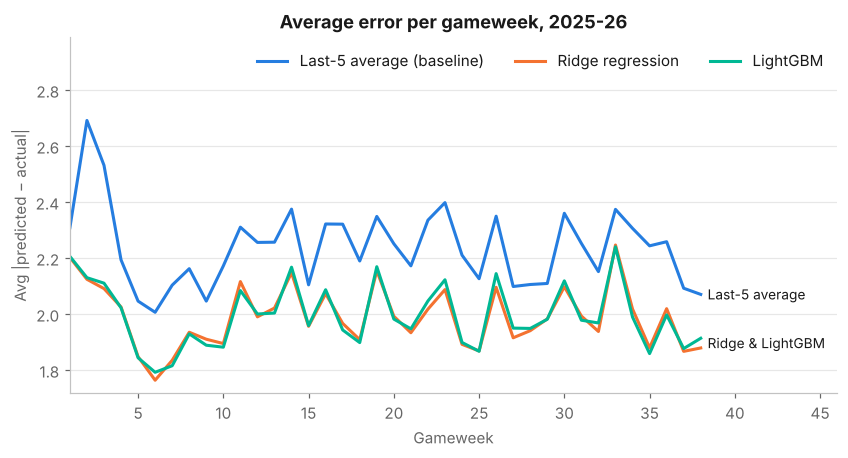

# FPL Lab: machine-learning model

Predicts how many FPL points each player will score in the next gameweeks, using
**LightGBM** (gradient-boosted decision trees) trained on five seasons of match data.
Its predictions appear on the app's **Accuracy** page next to the hand-written formula and
FPL's own official estimate, so the three can be compared on real results every week.

## Results

Time-based evaluation: the model is always tested on matches *after* the ones it learned from.

**Test: trained on 2022-23 to 2025-26, tested on 2026-27 GW1-10** (never used for any choice)

| Model | Avg error ↓ | Ranking ↑ | Top-10 picks (pts) ↑ |
|---|---|---|---|
| Last-5 average (baseline) | 2.23 | 0.28 | 4.02 |
| Ridge regression | 1.98 | 0.37 | 4.19 |
| **LightGBM** | **1.97** | 0.36 | **4.94** |

LightGBM's average error is **12% lower** than the baseline, and its top-10 picks score more.
Full tables (including the validation season and the FPL official estimate) are in
[reports/metrics.md](reports/metrics.md).



## How it works

```
 public dataset (5 seasons)          FPL API (this season + fixtures)
            │                                   │
            ▼                                   ▼
   fpl_ml/data.py                     fpl_ml/predict.py
            │                                   │
            └──────────►  fpl_ml/features.py  ◄─┘     same features for training and predicting
                                 │
                 fpl_ml/train.py │ models/fpl_lgbm.joblib
                                 ▼
                     Postgres table ml_predictions  ──►  Java app: Accuracy page
                     (every 6 hours, GitHub Actions)
```

1. **Data** (`fpl_ml/data.py`): the public [Fantasy-Premier-League dataset](https://github.com/vaastav/Fantasy-Premier-League),
   one row per player per fixture, seasons 2022-23 onwards (the ones with expected goals): ~120,000 rows.
2. **Features** (`fpl_ml/features.py`), 33 of them, each using **only matches before** the one being predicted:
   - form over the last 3 and 5 matches: minutes, points, xG, xA, bonus, BPS, saves, starts
   - share of recent matches with 60+ minutes, season points/minutes per match, season xG/xA per 90
   - price, position, home/away
   - team and opponent strength: goals and xG for/against over their last 6 matches
3. **Models** (`fpl_ml/models.py`): a last-5-average baseline, Ridge regression and LightGBM.
4. **Training and evaluation** (`fpl_ml/train.py`): validation on 2025-26 to choose settings, a final
   test on the current season, then a final model trained on everything.
5. **Predictions** (`fpl_ml/predict.py`): downloads this season's history and the upcoming fixtures from the
   FPL API, builds the same features, predicts each fixture, multiplies by FPL's chance-of-playing flag
   and stores the next 3 gameweeks in Postgres. A GitHub Actions workflow runs it every 6 hours.

## What the analysis found

- **Playing time dominates.** 59% of rows are players who didn't play; minutes over the last 3 matches is
  by far the most important feature. ([01_eda.ipynb](notebooks/01_eda.ipynb))
- **Form helps, but points are noisy.** Last-5 average points correlates 0.49 with next-match points; the same
  form can produce anything from 0 to 15 points.
- **Ridge ≈ LightGBM on average error.** With such a noisy target a linear model gets most of the way;
  LightGBM is kept because it picks better top players and handles missing early-season history.
  ([02_modeling.ipynb](notebooks/02_modeling.ipynb))
- **Well calibrated up to ~5 points;** the rare higher predictions are too optimistic.

## Run it

```bash
cd ml
python -m venv .venv && source .venv/bin/activate
pip install -r requirements-dev.txt
```

```bash
python -m fpl_ml.train      # download data, evaluate, save models/fpl_lgbm.joblib
```

```bash
python -m fpl_ml.predict --no-db    # predictions for the next 3 gameweeks -> output/predictions.csv
```

```bash
pytest -q tests             # includes a test that features never use the match's own result
```

To store predictions where the app reads them, set `DATABASE_URL_UNPOOLED` (the Neon connection string) and
run `python -m fpl_ml.predict`. In GitHub, add it as a repository secret and the
[ML predictions workflow](../.github/workflows/ml-predict.yml) does this every 6 hours.

## Limitations and next steps

- Rolling features restart every season, so the first gameweeks have little history; carrying a player's
  previous-season rates forward would help.
- Injury flags are only used at prediction time (multiplying the prediction), because the historical data
  doesn't include them.
- No separate set-piece or penalty-taker features yet.
- The dataset's `xP` column (FPL's estimate) may be recorded after kickoff, so it isn't a fair historical
  rival; the app's live comparison saves FPL's estimate before each deadline instead.
